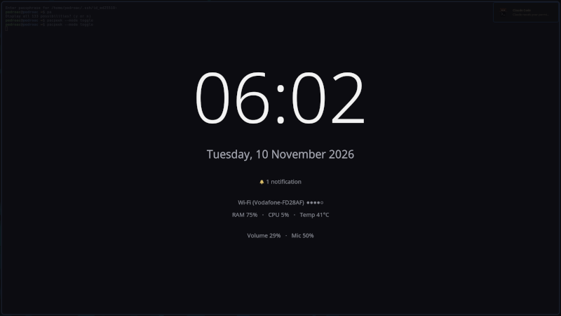

# pacpeek
**Task bars are bloated. Peek the status.**



A quick hotkey-powered panel to peek at system essentials on demand, without needing a permanent status bar.

`pacpeek` was built for tiling window managers like Hyprland and Sway to optimize how system status is delivered:

* **No configuration overhead:** Skip the upfront setup and complex styling layers (CSS, JavaScript, heavy configs). It works cleanly and readably right out of the box.
* **Reliability & clean presentation:** Built to offer a polished layout that doesn't suffer from stability issues or layout clutter.
* **Resource efficiency:** Designed specifically for low-RAM environments, eliminating background overhead for stats you only need to check occasionally.
* **Maximized screen space:** Since most tasks and window operations are handled naturally via the keyboard, status info only needs to be a quick "peek" rather than a permanent bar taking up display space.

If you already rely on keybindings, system status works best on demand.

`pacpeek` pops up for an instant look, disappears when you release the hotkey, and leaves anything that needs your attention to your desktop notifications.

## Quick start

```bash
make && sudo make install
```

Bind it in Hyprland (`hyprland.lua`), then hold the shortcut to peek and let go to close:

```lua
hl.bind("SUPER + Control_L", hl.dsp.exec_cmd("pacpeek --mode hold"))
```

If you prefer a toggle keybind (press to open, press again to close):

```lua
hl.bind("SUPER + Control_L", hl.dsp.exec_cmd("pacpeek --mode toggle --toggle"))
```

In Sway (`~/.config/sway/config`):

```
# hold to peek, let go to close
bindsym Mod4+Control_L exec pacpeek --mode hold
# or, instead: press to open, press again to close
# bindsym Mod4+Control_L exec pacpeek --mode toggle --toggle
```

If you follow those examples, make sure to press and hold the SUPER key first, then press Left Ctrl. It won't work if you press Left Ctrl first.

## Usage

```
pacpeek [--mode hold|toggle|external] [--timeout SECONDS] [--monitor NAME] [--toggle]
```

- `mode` (or `-m`): Determines how the overlay behaves and how it is dismissed:
  - `hold` (default): closes when a key is released.
  - `toggle`: closes on Esc.
  - `external`: takes no keyboard focus; the compositor closes it.
- `--timeout`: closes it automatically after the specified seconds.
- `--monitor`: picks the target screen/monitor name.
- `--toggle` (-T): if already running, closes the existing instance and exits; otherwise opens normally (ideal for a single toggle keybind).

## Platform

Linux only, tested on **Arch Linux with Hyprland and Sway**. It will probably not work elsewhere as it is: fork it and adapt it ([details](docs/platform.md)).

## Documentation

- [Usage](docs/usage.md): modes, options, keyboard focus, Hyprland and Sway binds, release-to-close
- [Configuration](docs/configuration.md): config file, environment variables, late-night clock, colors, fonts
- [Translations](docs/translations.md): languages, fonts per language, adding a language
- [Building and installing](docs/building.md): dependencies, install options, minimal build
- [Platform support and known limits](docs/platform.md)
- [Development](docs/development.md): source layout

## AI Assistance Disclosure

AI tools were used during the development of pacpeek for:

- Architecture & Ideation: Discussing design trade-offs (e.g., C-first philosophy, avoiding heavy dependencies, and leveraging wlr-layer-shell).
- Quality & Security Auditing: Reviewing code for correctness, safety, and reliability.
- Code Refinement: Structuring low-level Wayland and Cairo calls, and handling focus/input behavior.
- Documentation & Localization: Drafting documentation and initial translation catalogs (po/).

All code was reviewed, tested, and curated by the human author to ensure performance, security, and minimal overhead.

## License

MIT, see [LICENSE](LICENSE). The bundled wlroots protocol file keeps its own notice.
